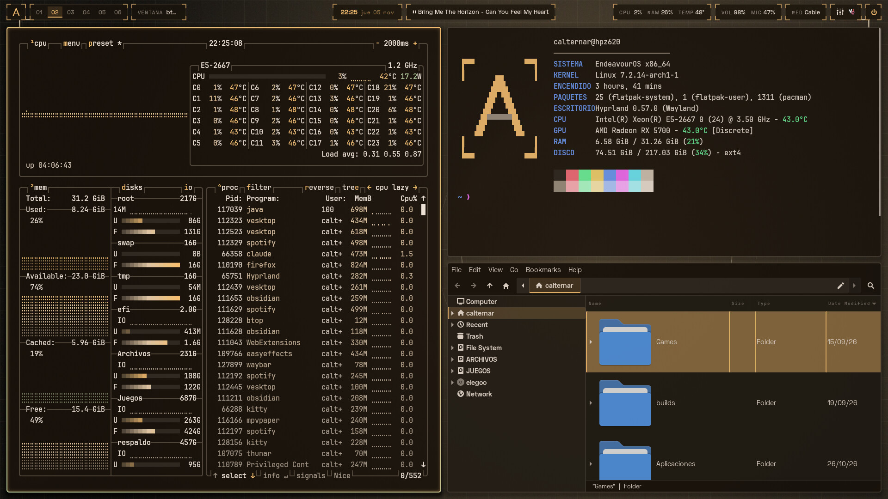
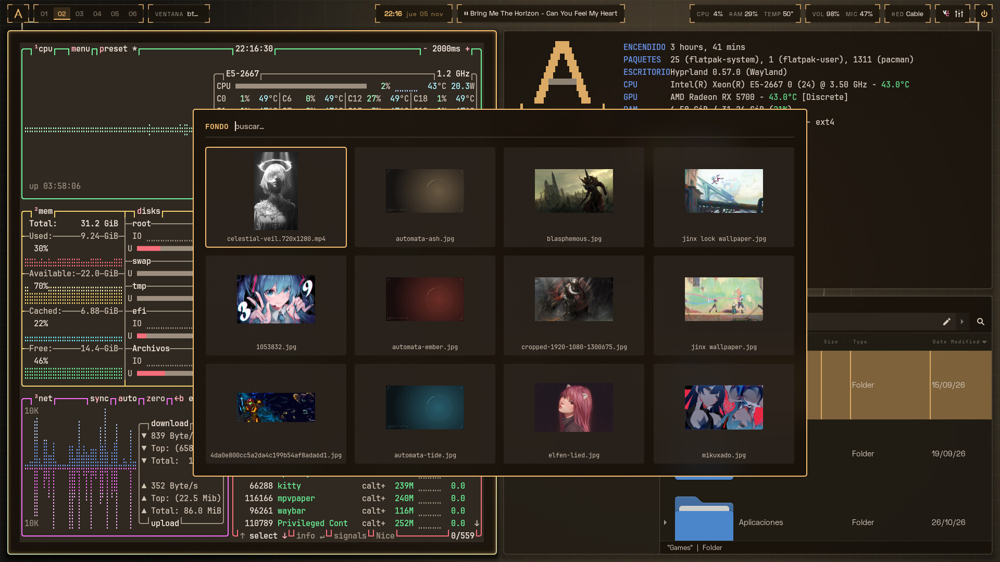
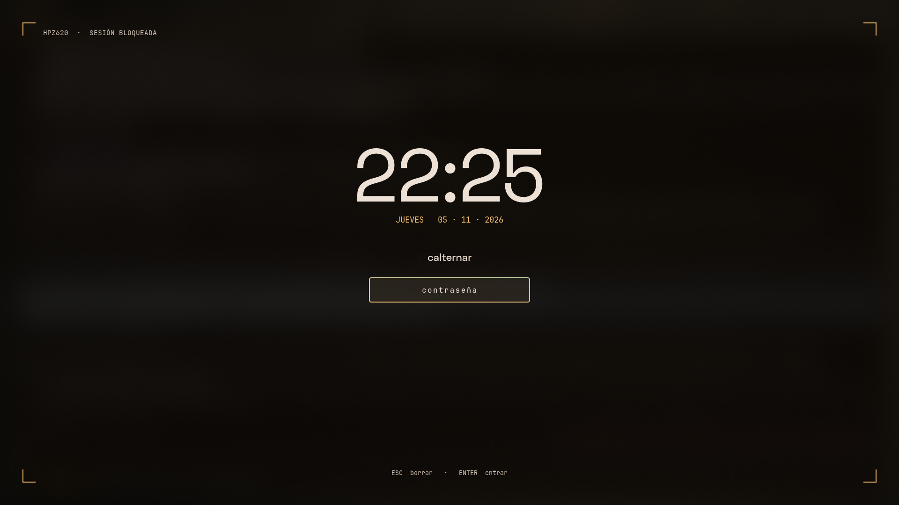
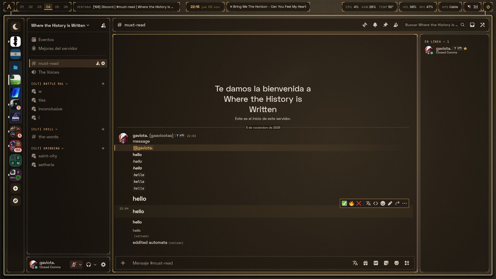
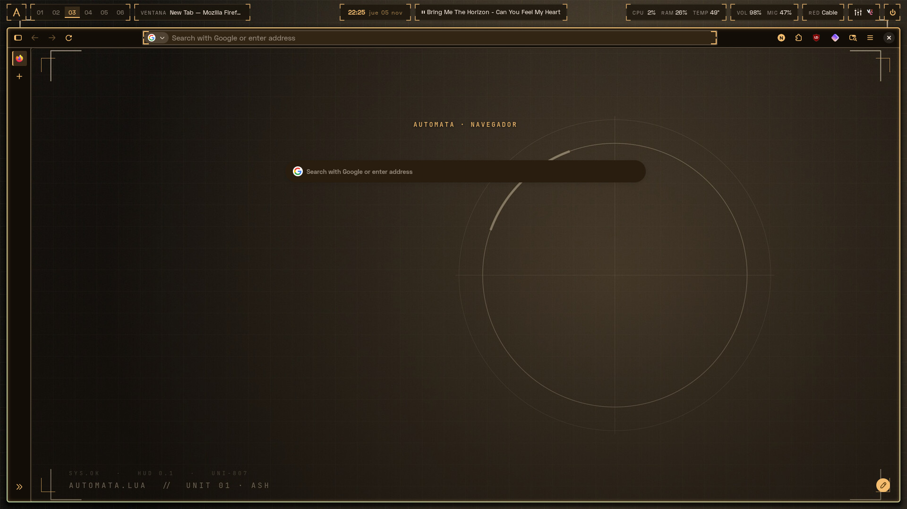
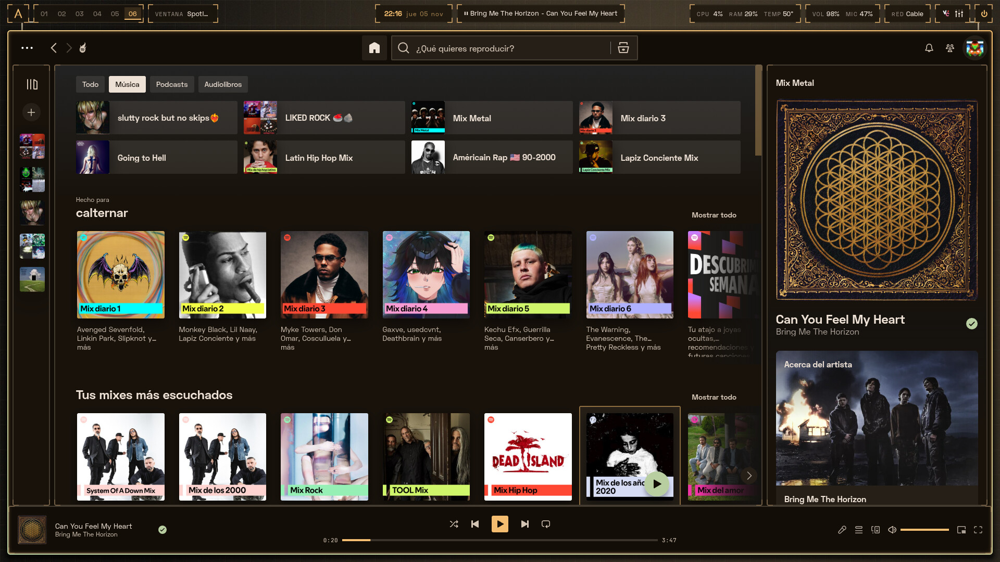
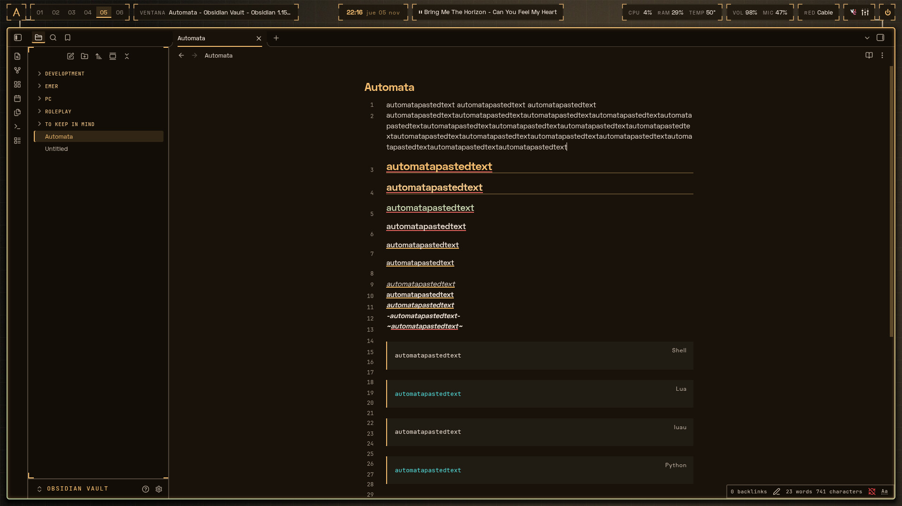
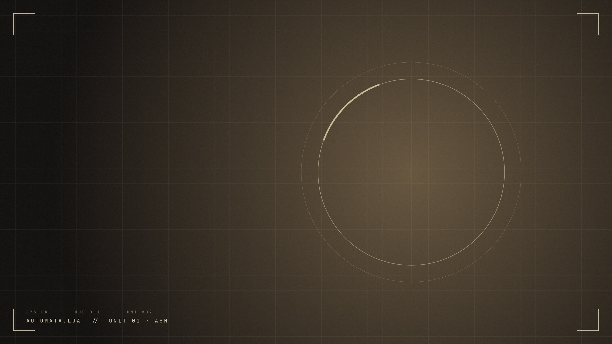
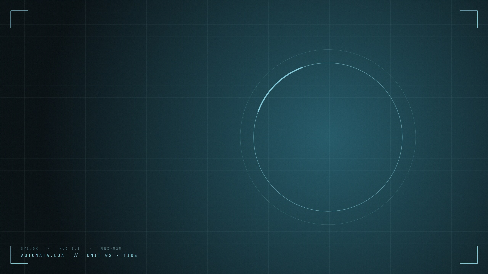
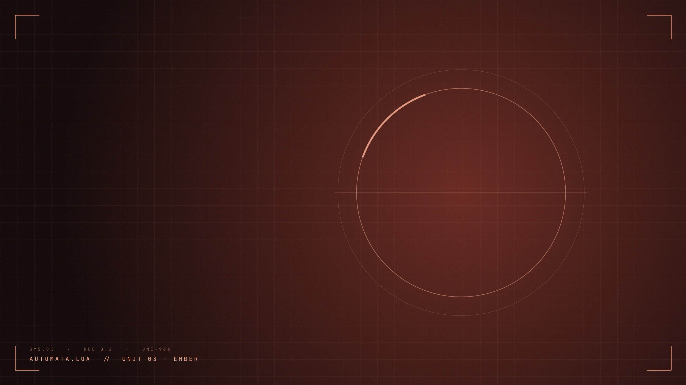

<div align="center">


# automata.lua

Un rice para Hyprland con estética HUD. Toma los colores de tu fondo de pantalla y los aplica a todo el escritorio.


[English](README.md)

</div>

| Escritorio | Lanzador + selector de fondos | Bloqueo |
|:---:|:---:|:---:|
|  |  |  |
| **Discord (Vesktop)** | **Firefox** | **Spotify** |
|  |  |  |
| **Obsidian** | | |
|  | | |

## Qué es

La configuración de mi propio escritorio, ordenada para que cualquiera la pueda instalar. Incluye:

- Configuración para Hyprland, la barra, la terminal, el lanzador, las notificaciones, la pantalla de
  bloqueo y la de inicio de sesión, además de temas para Discord (Vesktop), Firefox, Obsidian y Spotify.
- Un instalador que pregunta qué quieres antes de tocar nada.
- Un menú de ajustes (`automata`) para cambiar cosas después sin editar archivos.

Cuando cambias el fondo (imagen o video), [matugen](https://github.com/InioX/matugen) saca una paleta
de él y todas las apps de arriba se recargan con los colores nuevos. No hace falta reiniciar nada.

El estilo: marcos finos con esquinas tipo HUD, bordes casi rectos, Space Grotesk y JetBrains Mono.

## Compatibilidad

| | |
|---|---|
| **Distro** | Arch y derivadas (EndeavourOS, CachyOS, Manjaro…). En otras tendrías que instalar los paquetes a mano |
| **Hyprland** | 0.55 o más nuevo (usa la configuración en Lua). Probado por última vez en 0.57 |
| **Probado en** | EndeavourOS, GPU AMD, PC de escritorio, un monitor |
| **Portátiles** | La batería aparece en la barra y las teclas de brillo funcionan |
| **NVIDIA** | Se detecta y se ponen las variables que indica la wiki de Hyprland. No probado en hardware real |
| **Varios monitores / HiDPI** | `automata` → Monitores |
| **Shells** | bash, zsh y fish |

## Módulos

Tú eliges cuáles instalar. Las apps que ya tienes vienen marcadas.

| Módulo | Qué hace |
|---|---|
| **Hyprland** | Gestor de ventanas: bordes, animaciones, blur, atajos, bloqueo (hyprlock), inactividad (hypridle) |
| **Waybar** | Barra: escritorios, ventana activa, reloj, música, CPU/RAM/temperatura, batería, audio, red, menú de energía |
| **Rofi** | Lanzador de apps, selector de fondos con miniaturas, historial del portapapeles, menú de energía |
| **Kitty** | Terminal |
| **Dunst** | Notificaciones |
| **GTK** | Colores para apps GTK 3/4 (Thunar, ajustes…) |
| **Shell** | Prompt, `ls` con íconos (eza), `cd` con zoxide, búsqueda en el historial con fzf, fastfetch con el logo de automata |
| **Vesktop** | Tema para Discord, basado en [Midnight](https://github.com/refact0r/midnight-discord) |
| **Firefox** | Tema de la interfaz, tu fondo en la pestaña nueva, colores en vivo con Pywalfox |
| **Obsidian** | Snippet CSS para tu bóveda |
| **Spotify** | Tema de Spicetify. Los colores cambian en vivo, sin correr `spicetify apply` cada vez |
| **SDDM** | Pantalla de inicio de sesión. Necesita sudo y muestra antes los comandos exactos |

## Instalar

```bash
git clone https://github.com/ianrv9/automata.lua
cd automata.lua
./install
```

El instalador pasa por estos pasos:

1. **Idioma**: inglés o español. También se aplica al escritorio (barra, menús, bloqueo).
2. **Módulos**: cuáles instalar.
3. **Ajustes**: *Rápida* usa los valores por defecto. *Personalizada* pregunta por terminal, gestor de
   archivos, navegador, teclado, carpeta de fondos, estilo de color, aspecto, posición de la barra,
   tiempos de bloqueo y fuentes.
4. **Tu configuración anterior de Hyprland**, si existe: los atajos, monitores, variables y programas de
   inicio se copian a `~/.config/hypr/personal.lua`. Los atajos que chocan con los de automata quedan
   comentados.
5. **Paquetes**: lista lo que falta y muestra el comando de instalación antes de ejecutarlo.
6. **Plan**: lista qué archivos tuyos se van a reemplazar. Hasta aquí no ha cambiado nada.
7. **Instalación**: copia los archivos, respalda los que reemplaza y genera los colores.
   Empieza con el fondo oficial *Unit 01 · Ash*.
8. **Extras**: perfil de Firefox, Spotify, pantalla de inicio. Cada uno pregunta antes.

`./install --dry-run` hace todo el recorrido sin cambiar nada, para ver qué haría.

Los archivos reemplazados se respaldan en `~/.local/state/automata/backups/`. `automata uninstall` los devuelve.

## Fondos oficiales

automata trae tres fondos. Cada uno da una paleta distinta, así que sirven para ver rápido cómo
cambian los colores. Siempre aparecen en el selector (**Super + W**), después de los tuyos.

| Unit 01 · Ash | Unit 02 · Tide | Unit 03 · Ember |
|:---:|:---:|:---:|
|  |  |  |

Se generan con `tools/make-wallpaper.sh`, que puede hacer más en otros colores.

## Ajustes

Ejecuta `automata`:

```
 ▸ Estilo: separación, bordes, blur, animaciones
   Aplicaciones: terminal, archivos, navegador
   Distribución del teclado
   Monitores: modo, escala, posición
   Fondo y colores
   Barra
   Bloqueo y apagado de pantalla
   Fuentes
   Idioma / Language
   Agregar o quitar módulos
   Desinstalar y restaurar archivos anteriores
```

Los cambios se aplican al momento. Se guardan en `~/.config/automata/settings.conf`, que también puedes
editar a mano y luego ejecutar `automata apply`:

| Ajuste | Qué hace | Por defecto |
|---|---|---|
| `LANGUAGE` | `en` o `es` | el de tu sistema |
| `WALLPAPER_DIR` | tu carpeta de fondos | `~/Pictures/Wallpapers` |
| `COLOR_SCHEME` | cómo se hace la paleta: `scheme-content`, `scheme-tonal-spot`, `scheme-vibrant`, `scheme-expressive`, `scheme-monochrome` | `scheme-content` |
| `TERMINAL` / `FILE_MANAGER` / `BROWSER` | qué abren Super + Q / E / B | kitty / thunar / firefox |
| `KB_LAYOUT` / `KB_VARIANT` | distribución del teclado | la que usas ahora |
| `GAPS_IN` / `GAPS_OUT` | espacio entre ventanas / alrededor de la pantalla | 6 / 14 |
| `BORDER_SIZE` / `ROUNDING` | grosor del borde / redondeo de esquinas | 2 / 4 |
| `BLUR` | blur detrás de la barra, menús y terminal | yes |
| `ANIMATIONS` | `fast`, `relaxed` u `off` | fast |
| `INACTIVE_OPACITY` | opacidad de las ventanas sin foco | 0.94 |
| `BAR_POSITION` | `top` o `bottom` | top |
| `FONT_UI` / `FONT_MONO` | fuentes | Space Grotesk / JetBrainsMono Nerd Font |
| `LOCK_AFTER` / `SCREEN_OFF_AFTER` | minutos de inactividad, `0` = nunca | 10 / 11 |
| `MONITORS` | modo, posición y escala de cada monitor (lo llena el menú) | automático |
| `GPU` | `nvidia` agrega las variables de NVIDIA | detectado |

### Cambios propios

- **Hyprland** (monitores, atajos, programas de inicio): `~/.config/hypr/personal.lua`. Se carga al
  final, así que manda sobre todo lo demás, y las actualizaciones no lo tocan.
- **Plantillas extra de matugen**: `~/.config/automata/matugen-extra.toml`.
- **Lo demás**: los archivos que instala automata se reescriben en cada apply. Si editas uno a mano,
  automata guarda una copia de tu versión en los respaldos y te dice dónde. Para cambiar un módulo de
  forma permanente, haz un fork del repo y edita `modules/<nombre>/`.

## Atajos

| Teclas | Acción |
|---|---|
| `Super + Q` | Terminal |
| `Super + R` | Lanzador de apps |
| `Super + E` | Gestor de archivos |
| `Super + B` | Navegador |
| `Super + W` | Selector de fondos |
| `Super + C` | Cerrar ventana |
| `Super + V` | Hacer flotante / volver al mosaico |
| `Super + P` | Pseudo-mosaico |
| `Super + J` | Cambiar la dirección de división |
| `Super + flechas` | Mover el foco |
| `Super + 1…0` | Ir al escritorio |
| `Super + Shift + 1…0` | Mover la ventana al escritorio |
| `Super + rueda del ratón` | Escritorio siguiente / anterior |
| `Super + S` / `Super + Alt + S` | Mostrar el scratchpad / mandar la ventana ahí |
| `Super + Shift + S` o `Impr` | Captura de una zona (abre swappy) |
| `Super + Shift + V` | Historial del portapapeles |
| `Super + L` | Bloquear |
| `Super + Supr` | Apagar la pantalla |
| `Super + M` | Cerrar sesión (pregunta antes) |
| `Super + arrastrar con clic izquierdo / derecho` | Mover / redimensionar ventana |

Las teclas multimedia, de volumen y de brillo funcionan como se espera.

## Actualizar

```bash
cd automata.lua && git pull && ./install
```

Si automata ya está instalado, el instalador pregunta qué hacer:

- **Actualizar con la configuración actual**: sin preguntas.
- **Cambiar una parte de la configuración**: después eliges entre aplicar solo eso o seguir la
  configuración desde ahí.
- **Configurar todo de nuevo**.

`settings.conf` y `personal.lua` se conservan.

## Desinstalar

```bash
automata uninstall
```

Restaura tus archivos anteriores y quita lo que agregó automata. Los paquetes instalados se quedan.

## Cómo funciona

```
 fondo ──► change-wallpaper ──► matugen ──► plantillas ──► colors.css, colors.lua, …
   │                                                              │
   └──► mpvpaper (lo muestra, videos también)     cada app recarga su archivo de colores
```

- matugen llena una plantilla por app. Waybar, kitty, dunst, Hyprland, Obsidian y Vesktop recargan
  esos archivos solos. Spotify tiene un pequeño script que revisa si hay colores nuevos cada 2 segundos,
  y Firefox usa Pywalfox.
- El instalador (`bin/automata`) es bash. Cada carpeta en `modules/` es un módulo:

  ```
  modules/waybar/
  ├── module.conf    nombre, descripción, paquetes, dependencias
  ├── home/          archivos que se copian a tu $HOME
  ├── templates/     plantillas de matugen
  ├── matugen.toml   qué plantilla genera qué archivo
  └── post.sh        pasos extra opcionales
  ```

  Los archivos pueden usar marcadores `@@AJUSTE@@` y `@@t:texto@@`, que se reemplazan con tus ajustes
  y el idioma elegido al instalar. Agregar un módulo es agregar una carpeta.

## Problemas

Mira [docs/troubleshooting.es.md](docs/troubleshooting.es.md). Si no está ahí, abre un issue con la
salida de `automata info`.

Hyprland, Discord y Firefox cambian seguido. `automata info` muestra la última versión de Hyprland con
la que se probó, y el instalador avisa si la tuya es más nueva.

## Créditos

- [matugen](https://github.com/InioX/matugen) por las paletas.
- [Midnight](https://github.com/refact0r/midnight-discord) de refact0r, la base del tema de Vesktop.
- [gum](https://github.com/charmbracelet/gum) por los menús del instalador.
- Fuentes: [Space Grotesk](https://github.com/floriankarsten/space-grotesk), [JetBrains Mono Nerd Font](https://www.nerdfonts.com/).

MIT © Calternar
